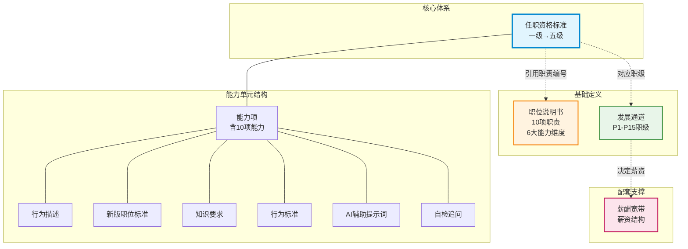
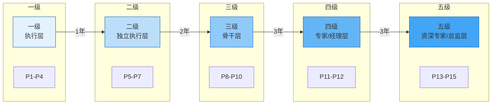
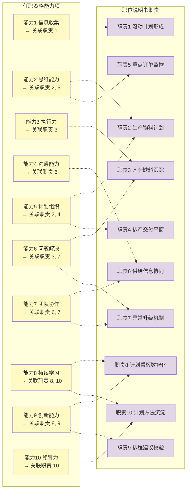
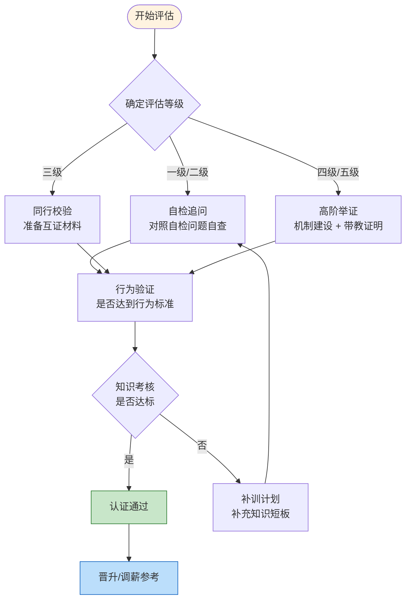

# PMC经理任职资格 - 关系图谱

> 本页用可视化方式展示知识库中各个模块之间的关联关系。

---

## 一、整体数据模型

下图展示知识库的核心实体及其关联关系：

---

## 二、等级与职级对应关系

---

## 三、能力模型结构

每个等级包含 **10项能力**，每项能力由 7 个维度构成：

```mermaid
graph TB
    subgraph 10项能力
        C1[1. 信息收集]
        C2[2. 思维能力]
        C3[3. 执行力]
        C4[4. 沟通能力]
        C5[5. 计划组织]
        C6[6. 问题解决]
        C7[7. 团队协作]
        C8[8. 持续学习]
        C9[9. 创新能力]
        C10[10. 领导力]
    end

    subgraph 每个能力的构成维度
        D1[行为描述<br/>做什么]
        D2[新版职位标准<br/>达到什么水平]
        D3[知识要求<br/>知道什么]
        D4[行为标准<br/>怎么做好]
        D5[认证/验证方式<br/>怎么证明]
        D6[AI辅助提示词<br/>工具怎么用]
        D7[自检追问<br/>怎么自我评估]
    end

    C1 --- D1 & D2 & D3 & D4 & D5 & D6 & D7
    C2 --- D1 & D2 & D3 & D4 & D5 & D6 & D7
    C3 --- D1 & D2 & D3 & D4 & D5 & D6 & D7
    C4 --- D1 & D2 & D3 & D4 & D5 & D6 & D7
    C5 --- D1 & D2 & D3 & D4 & D5 & D6 & D7
    C6 --- D1 & D2 & D3 & D4 & D5 & D6 & D7
    C7 --- D1 & D2 & D3 & D4 & D5 & D6 & D7
    C8 --- D1 & D2 & D3 & D4 & D5 & D6 & D7
    C9 --- D1 & D2 & D3 & D4 & D5 & D6 & D7
    C10 --- D1 & D2 & D3 & D4 & D5 & D6 & D7

    style C1 fill:#e8f5e9
    style C2 fill:#e8f5e9
    style C3 fill:#e8f5e9
    style C4 fill:#e8f5e9
    style C5 fill:#e8f5e9
    style C6 fill:#e8f5e9
    style C7 fill:#e8f5e9
    style C8 fill:#e8f5e9
    style C9 fill:#e8f5e9
    style C10 fill:#e8f5e9
```

---

## 四、能力项 → 职责映射

任职资格标准中的每个能力项通过「关联职责」字段引用[[01-职位说明书]]中的具体职责：

---

## 五、认证与评估流程

---

## 六、文件导航

| 节点 | 出链（指向） | 入链（被指向） |
|------|------------|-------------|
| [[readme]] | 全部4个模块 | — |
| [[01-职位说明书]] | 03-任职资格标准、02-发展通道、04-薪酬宽带 | 03-任职资格标准 |
| [[02-发展通道]] | 03-任职资格标准、04-薪酬宽带 | 01-职位说明书、03-任职资格标准、04-薪酬宽带 |
| [[03-任职资格标准]] | 01-职位说明书、02-发展通道、04-薪酬宽带 | 01-职位说明书、02-发展通道、04-薪酬宽带 |
| [[04-薪酬宽带]] | 02-发展通道、03-任职资格标准 | 01-职位说明书、02-发展通道、03-任职资格标准 |

> **提示**：在 Obsidian 中打开 Graph View（全局关系图），可以看到所有笔记之间的连线。每个笔记的「关联关系」段落为手动标注的双向链接。
